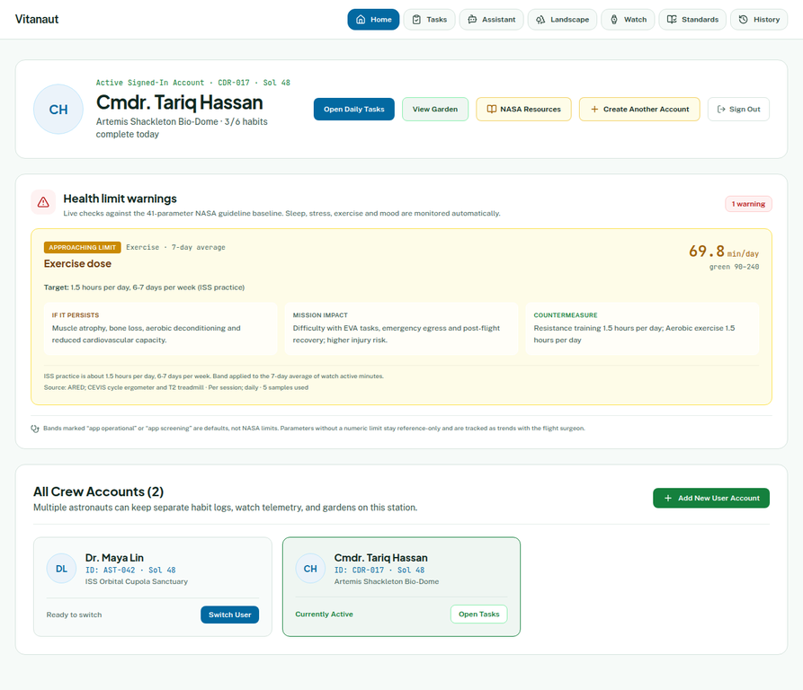

# Vitanaut — Start Here

This guide assumes no programming experience. There are two ways to use Vitanaut:

1. **Open the live link** — nothing to install (fastest).
2. **Run it on your own computer** — double-click one file after installing Node.js once.

---

## Part 1 — Use it right now (nothing to install)

I have already started the app for you. Open this link in Chrome, Edge, Firefox or Safari:

**https://eizer-56-10-141-246.free.pinggy.net**

You will see a Pinggy safety page first. Click **Enter site** once. That page exists because this is a free preview tunnel, not the final hosted version.

Sign in with one of the demo astronauts:

| Astronaut ID | Password |
|---|---|
| `CDR-017` | `artemis` |
| `AST-042` | `orbit2026` |

A second link is available if the first one is slow: **http://bore.pub:55505**. It opens without the warning page, but it is not encrypted, so only use the demo passwords there.

**These preview links are temporary.** They run from my working environment and will stop when it sleeps. For something permanent, follow Part 4.

### A five-minute tour

1. **Home** shows the astronaut, today's habit progress, and the **Health limit warnings** panel. A yellow card means “approaching limit”; a red card means “limit exceeded”.
2. **Tasks** is the daily check-in: exercise, sleep, nutrition, hydration and mental-health habits.
3. **Watch** shows wearable readings and the same warning panel next to them.
4. **History** shows the astronaut's own past check-ins and readings.
5. **Landscape** is the garden that reflects overall health.



---

## Part 2 — Run it on your own computer

You only need to do steps 1 and 2 once.

### Step 1: Install Node.js

1. Go to **https://nodejs.org**.
2. Download the **LTS** version (the big green button).
3. Run the installer and click Next/Continue until it finishes. You do not need to change any options.
4. Restart your computer if the installer asks you to.

Node.js is the engine that runs the app. You will not need to open it or configure it.

### Step 2: Unzip the project

1. Download **Vitanaut_deployable.zip** from this task.
2. Right-click the ZIP file and choose **Extract All** (Windows) or double-click it (Mac).
3. Move the extracted `vitanaut_app` folder somewhere simple, such as your **Desktop** or **Documents**. Avoid `Program Files` and avoid a folder that syncs to OneDrive while the app is running.

### Step 3: Start it

**Windows**

Double-click **`start-windows.bat`**. If Windows shows a blue “Windows protected your PC” message, click **More info → Run anyway**. The script installs the app the first time (a few minutes) and then opens your browser.

**Mac**

Double-click **`start-mac.command`**. The first time, macOS may block it: right-click the file, choose **Open**, then **Open** again. If it still refuses, open Terminal, type `chmod +x ` (with a space at the end), drag the file into the Terminal window, press Enter, then double-click the file again.

**Linux**

Open a terminal in the folder and run `./start-linux.sh`.

### Step 4: Use the app

A black/blue terminal window will stay open. That window **is the server** — keep it open while you use the app. Your browser should open automatically at:

**http://localhost:3000**

If it does not open, type that address into your browser yourself.

The first load can take 5–10 seconds. After that it is fast.

### Step 5: Stop it

Close the terminal window, or click inside it and press **Ctrl+C**. To use the app again later, double-click the same start file. It will be much faster because everything is already installed.

---

## Part 3 — Create your own account

1. On the sign-in screen, click **Create Another Account** (or use the onboarding form on the left).
2. Enter your name, an Astronaut ID of your choice (for example `AST-101`), a password of at least 4 characters, and pick a mission landscape.
3. Click **Create Account & Enter Home**.

Each astronaut gets a private history, private wearable data and a private garden. You can switch between accounts with **Switch User**.

To make a warning appear, open **Watch** and click **Sync** a few times, or complete the daily tasks. The demo data is tuned so that `CDR-017` shows an “approaching limit” exercise warning.

---

## Part 4 — Put it online permanently

The ZIP includes everything a hosting company needs. You have two realistic options.

### Option A — Vercel (recommended)

Vercel needs a free account because the app must belong to you.

1. Create an account at **https://vercel.com** (Google, GitHub or email).
2. Ask me for the current claim link, or run `vercel` from the project folder.
3. Open the claim link, log in, choose your team and click **Transfer**. The temporary deployment then becomes a permanent project.
4. In the project, open **Settings → Environment Variables** and add `OPENAI_API_KEY` if you want the full LLM assistant. Without a key, the Assistant still works with built-in guidance.
5. Click **Redeploy** after adding the variable.

**Important:** Vercel's serverless filesystem is temporary. The demo accounts reseed automatically, but accounts and history created by users may disappear when the app restarts. For a permanent database, connect a hosted Postgres/Neon database; this needs a small code change that I can do next.

### Option B — Docker (one command on any server)

If you or your team have a server with Docker installed:

```bash
docker build -t vitanaut .
docker run -d --name vitanaut -p 3000:3000 -v vitanaut-data:/app/data vitanaut
```

Then open `http://your-server-address:3000`. The `vitanaut-data` volume keeps the database safe when the container is updated. Put Nginx or Caddy in front of it for HTTPS.

The full technical deployment notes, including Fly.io and Railway, are in [DEPLOY.md](DEPLOY.md).

---

## Part 5 — Troubleshooting

| Problem | What to do |
|---|---|
| “Node.js is not installed” or `node` is not recognized | Install the LTS version from nodejs.org, then **restart the computer** and try again. |
| The start file opens and closes immediately | Right-click it and choose “Run as administrator” (Windows), or run it from Terminal to see the error. |
| “Port 3000 is already in use” | Another copy is already running. Close the other terminal window, or restart the computer. |
| The browser shows a blank page | Wait 10 seconds and refresh. If it stays blank, stop the server (Ctrl+C) and start it again. |
| `npm install` fails | Check the internet connection. If you are on a company network, try a normal home connection. |
| The preview link does not open | The temporary tunnel has expired. Run the app locally with Part 2, or deploy it with Part 4. |
| I forgot the demo password | Use `artemis` for `CDR-017` or `orbit2026` for `AST-042`. |
| I want to reset all data | Stop the app, delete the `data` folder inside `vitanaut_app`, and start it again. It recreates the demo database. |

---

## Part 6 — What is inside the ZIP

| File or folder | What it is |
|---|---|
| `start-windows.bat`, `start-mac.command`, `start-linux.sh` | Double-click starters. They install and run the app. |
| `src/` | The screens you see: Home, Tasks, Assistant, Watch, History, Landscape. |
| `server.ts`, `server/` | The backend: accounts, private data, wearable readings, warnings. |
| `db/` | The 41-parameter guideline baseline and the database schema. |
| `data/` | Created automatically on first run. Holds the database. Back this up. |
| `Dockerfile`, `docker-compose.yml`, `render.yaml`, `fly.toml` | Hosting configurations. You do not need to edit them. |
| `DEPLOY.md` | Technical deployment instructions for a developer or hosting provider. |
| `README.md`, `docs/BACKEND.md` | Technical documentation for whoever maintains the app. |
| `scripts/` | Tests and the catalog builder. Not needed to use the app. |

---

## Part 7 — Important limitations

- **Four parameters are checked automatically**: sleep duration, stress, 7-day exercise minutes and 7-day mood. The other 37 parameters are stored as reference data in the backend but stay reference-only until the app receives their data (fluid intake, VO2max, DXA bone density, light exposure, symptom diaries, and so on).
- Some bands are **app defaults**, not NASA limits. The backend labels these honestly; they should be reviewed with a flight surgeon before operational use.
- This is a **prototype for a challenge**, not a medical device. Do not use it for real clinical decisions.
- The demo passwords are public in this guide. Before any real deployment, create new accounts and remove the demo ones.
- Health data is sensitive. Use HTTPS, restrict access to the server and its backups, and do not share the database file.

---

## The absolute shortest version

1. Open **https://eizer-56-10-141-246.free.pinggy.net**, click **Enter site**, sign in with `CDR-017` / `artemis`.
2. To run it yourself: install Node.js LTS, unzip the folder, double-click the starter for your operating system, and open **http://localhost:3000**.
3. To put it online: create a Vercel account, open the claim link I send you, and transfer the deployment. Add `OPENAI_API_KEY` in Vercel settings to enable the full LLM.
